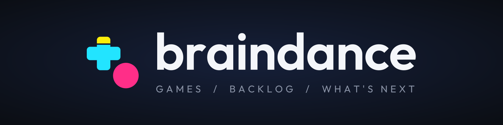

# Braindance
        

Find what to play next. Braindance brings popular games, upcoming releases, similar titles, and free giveaways
together in one place.

**[Open the experimental Web preview](https://app.braindancegg.com/)** ·
[Report a bug](https://github.com/vladleesi/braindance/issues/new?template=bug_report.md) ·
[Contribute](CONTRIBUTING.md)

## Discover your next game

- Explore **Popular Right Now** and **Most Anticipated** to find released and upcoming games.
- View game details and discover similar games.
- Browse giveaways, read their instructions, and follow links to claim them.

Personal tracking, collections, search results, news, and account management are not available yet.
Game data comes from IGDB, and giveaways from GamerPower.

## Platforms

| Platform | Availability |
| --- | --- |
| **Web (experimental)** | [Preview available now](https://app.braindancegg.com/) in a modern browser with WasmGC support. |
| Android and iOS | Official releases are planned; store downloads are not available yet. |

Braindance is actively developed toward a public launch, with no confirmed release date.
Web support is experimental: browser behavior, performance, and feature availability may change.
See [CHANGELOG.md](CHANGELOG.md) for updates across Android, iOS, and Web.

## Help improve Braindance

- [Report a bug](https://github.com/vladleesi/braindance/issues/new?template=bug_report.md).
- [Suggest a feature or share usability feedback](https://github.com/vladleesi/braindance/issues/new?template=feature_or_feedback.md).
- [Contribute code or documentation](CONTRIBUTING.md).

Feedback from the Web preview is welcome; you do not need to build the app or run a backend to participate.

## For developers

Android, iOS, and Web share UI and application logic through Kotlin Multiplatform and Compose Multiplatform.
A Kotlin/JVM Ktor backend keeps Twitch credentials server-side and provides IGDB and GamerPower data.
Its independent version is `0.11.1`. See the [backend changelog](backend/CHANGELOG.md) for release notes.

- [Development guide](docs/development.md): requirements, project layout, local builds, debugging, and validation.
- [Backend reference](backend/README.md): server configuration, API, packaging, and optional independent hosting.
- [Release guide](docs/releases.md): versioning and publication workflows.
- [Brand assets](docs/branding/README.md): logos, icons, banners, palette, and usage guidance.

The current frontend source version is
[0.11.0](https://github.com/vladleesi/braindance/releases/tag/app-v0.11.0).
GitHub releases provide source code, not store-ready mobile downloads.
Developer builds for Android, iOS, and Web are supported; see the development guide for backend configuration.

Publication badges show checks for the revision on `master`; a skipped backend check does not indicate a new deployment.

## License

First-party source, tests, build scripts, configuration, and documentation use [MPL-2.0](LICENSE).
Modification, redistribution, commercial use, and forks are permitted under its terms. Preserve notices and MPL
source rights; previously published GPL versions retain their rights. Third-party code, fonts, artwork, and external
data have separate terms and exclusions in [THIRD_PARTY_NOTICES.md](THIRD_PARTY_NOTICES.md).

For first-party files without inline comments, this notice applies:

> This Source Code Form is subject to the terms of the Mozilla Public License, v. 2.0.
> If a copy of the MPL was not distributed with this file, You can obtain one at https://mozilla.org/MPL/2.0/.

See [contribution requirements](CONTRIBUTING.md#licensing) and
[distribution guidance](docs/development.md#distribution) for notices, corresponding source, and third-party terms.
