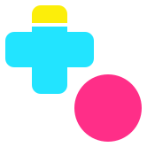

# Braindance
        

### Find what to play next.

Popular and upcoming games, similar titles and free giveaways — in one place. 
Open source for **Android · iOS · Web**.

**[braindancegg.com](https://braindancegg.com/)** &nbsp;·&nbsp; **[Open the web app](https://app.braindancegg.com/)**
&nbsp;·&nbsp; [Report a bug](https://github.com/vladleesi/braindance/issues/new?template=bug_report.md)
&nbsp;·&nbsp; [Contribute](CONTRIBUTING.md)

---

## 🎮 What's inside

Braindance helps you decide what to play next. No endless store pages — just a focused place to see what is hot,
what is coming and what is free.

| | |
| --- | --- |
| 🔥 **Popular Right Now** | See what everyone is playing today. |
| ⏳ **Most Anticipated** | Keep track of upcoming releases worth waiting for. |
| 🧭 **Game details & similar games** | Open any game, then jump to similar titles when you want more of the same. |
| 🎁 **Free giveaways** | Browse current giveaways, read the instructions and follow the link to claim. |

Game data comes from [IGDB](https://www.igdb.com/), and giveaways from [GamerPower](https://www.gamerpower.com/).

## 📱 Platforms

> [!NOTE]
> Braindance is in active development toward a public launch, with no confirmed release date. Personal tracking,
> collections, search results, news, and account management are not available yet.

| Platform | Availability |
| --- | --- |
| **Web (experimental)** | [Preview available now](https://app.braindancegg.com/) in a modern browser with WasmGC support. |
| Android and iOS | Official releases are planned; store downloads are not available yet. |

Web support is experimental: browser behavior, performance, and feature availability may change.
See [CHANGELOG.md](CHANGELOG.md) for updates across Android, iOS, and Web.

## 🤝 Help improve Braindance

- 🐞 [Report a bug](https://github.com/vladleesi/braindance/issues/new?template=bug_report.md).
- 💡 [Suggest a feature or share usability feedback](
  https://github.com/vladleesi/braindance/issues/new?template=feature_or_feedback.md).
- 🛠️ [Contribute code or documentation](CONTRIBUTING.md).

Feedback from the Web preview is welcome; you do not need to build the app or run a backend to participate.

## 🧩 For developers

Android, iOS, and Web share UI and application logic through Kotlin Multiplatform and Compose Multiplatform.
A Kotlin/JVM Ktor backend keeps Twitch credentials server-side and provides IGDB and GamerPower data.
Its independent version is `0.11.2`. See the [backend changelog](backend/CHANGELOG.md) for release notes.

| | |
| --- | --- |
| 📘 **[Development guide](docs/project/development.md)** | Requirements, project layout, local builds, debugging, and validation. |
| 🖥️ **[Backend reference](backend/README.md)** | Server configuration, API, packaging, and optional independent hosting. |
| 🚀 **[Release guide](docs/project/releases.md)** | Versioning and publication workflows. |
| 🎨 **[Brand assets](docs/project/branding/README.md)** | Logos, icons, banners, palette, and usage guidance. |
| 🌐 **[Landing site](docs/)** | The static page served at [braindancegg.com](https://braindancegg.com/). |

The current frontend source version is
[0.13.1](https://github.com/vladleesi/braindance/releases/tag/app-v0.13.1).
GitHub releases provide source code, not store-ready mobile downloads.
Developer builds for Android, iOS, and Web are supported; see the development guide for backend configuration.

Publication badges show checks for the revision on `master`; a skipped backend check does not indicate a new deployment.

## 📄 License

First-party source, tests, build scripts, configuration, and documentation use [MPL-2.0](LICENSE).
Modification, redistribution, commercial use, and forks are permitted under its terms. Preserve notices and MPL
source rights; previously published GPL versions retain their rights. Third-party code, fonts, artwork, and external
data have separate terms and exclusions in [THIRD_PARTY_NOTICES.md](THIRD_PARTY_NOTICES.md). Game covers shown on the
landing site are © their respective owners, via [IGDB](https://www.igdb.com/).

For first-party files without inline comments, this notice applies:

> This Source Code Form is subject to the terms of the Mozilla Public License, v. 2.0.
> If a copy of the MPL was not distributed with this file, You can obtain one at https://mozilla.org/MPL/2.0/.

See [contribution requirements](CONTRIBUTING.md#licensing) and
[distribution guidance](docs/project/development.md#distribution) for notices, corresponding source, and third-party
terms.

---

<b>braindance</b> · games / backlog / what's next

